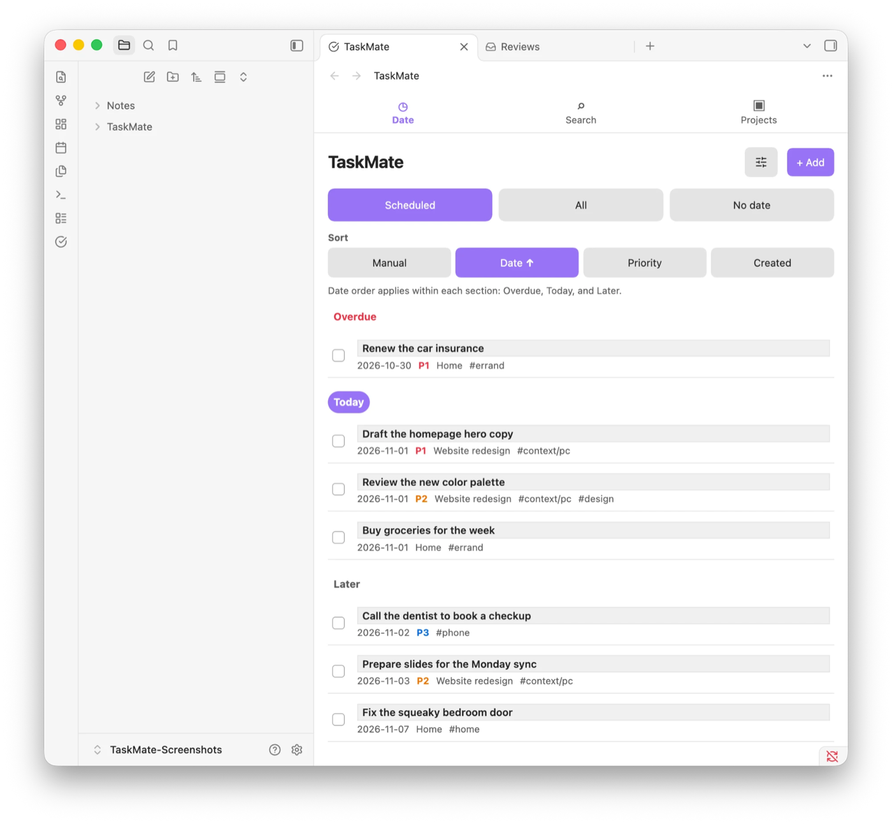
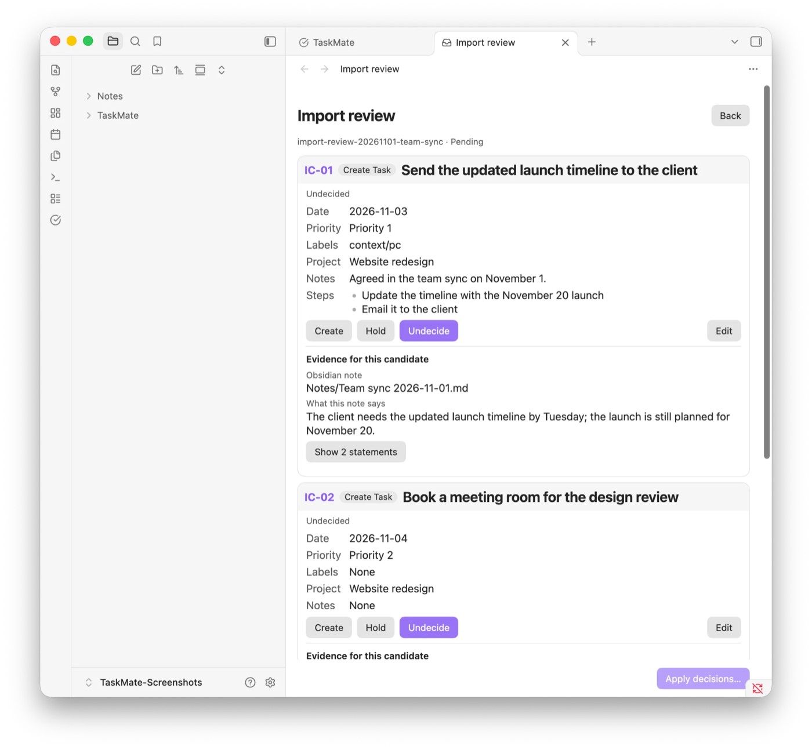

# TaskMate

[English](README.md) | 日本語

<!-- translation-status: ai-translated -->
<!-- translation-source-sha256: d9a543ac1597cd4844706be8a3e5a37136c21ff8c4616de3c10270e5afca1b14 -->

> 翻訳状態：`ai-translated`
>
> この日本語版は英語版を原本としてAIで翻訳されています。現在は人間による全文確認を完了していません。内容が異なる場合は英語版を正式な情報として扱ってください。

TaskMateは、Vaultを離れずにTodoistのような目的を絞ったタスク一覧を使いたいObsidian利用者向けの、シンプルでローカルファーストなタスク管理ツールです。すべてのタスクとプロジェクトは、自分で持てる読みやすいMarkdownとして残ります。

TaskMateには、任意で使えるAIエージェントスキル、Task Pilotも含まれます。選んだノートからタスクの候補や計画を作り、TaskMateのレビューで承認するまでタスクを変更しません。



## TaskMateを選ぶ理由

- PC版とモバイル版のObsidianで同じタスク画面を使用できます。
- 他の組み込みビューで順序を失わず、タスクを手動で並べ替えられます。
- タスクを確認・移行・編集可能なMarkdownとして保持できます。
- TaskMateアカウントやホストされたデータベースを作成せずにプラグインを使用できます。
- AIが生成した提案を正式なタスクにする前に確認できます。

## インストール

TaskMateはまだObsidian Community directoryに掲載されていないため、GitHub Release（0.7.0以降）から入れます。PC版とAndroid版のObsidianで確認済みで、iOSはまだ確認していません。

1. [TaskMate Releasesページ](https://github.com/tempu-village/taskmate/releases)を開き、同じバージョンの次の3ファイルをダウンロードします。

   ```text
   main.js
   manifest.json
   styles.css
   ```

2. `<vault>/.obsidian/plugins/taskmate/`を作成し、3ファイルをその直下へ置きます。
3. Obsidianを再起動し、**設定 → コミュニティプラグイン**からTaskMateを有効にします。

更新する場合は、Vaultをバックアップし、TaskMateを無効にして、1つの新しいReleaseに含まれる3ファイルをすべて置き換えてから、TaskMateを再び有効にします。異なるバージョンのファイルを混在させないでください。

未公開のビルドを動かす場合は、[開発ビルドを入れる](docs/operations/development-install.md)を参照してください。

## クイックスタート

初回の練習は[最初のTaskMateタスク](docs/user/getting-started.md)、目的別の操作は[利用者向けガイド](docs/user/README.md)を参照してください。

1. TaskMateを[インストール](#インストール)して有効にします。
2. コマンドパレットを開き、**TaskMate: タスク一覧を開く**を実行します。
3. **＋ 追加**を選択し、タイトルを入力してタスクを保存します。
4. 日付画面で予定、すべて、日付なしのタスクを表示します。現在の一覧を絞り込む、または選択するには調整メニューを使います。
5. **設定 → TaskMate → 言語**で、自動、English、日本語のいずれかを選択します。

言語を変更するとTaskMateのビューと設定画面はすぐに更新されます。コマンド名とリボンの説明を更新するには、プラグインを再読み込みしてください。

## 現在の機能

- 日付、検索、プロジェクトの3つに絞った移動先
- 予定、すべて、日付なしのビューと、予定内の期限切れ・今日・明日以降セクション
- 現在の一覧へフィルターを適用し、明示的なタスク選択を開始できる調整メニュー
- 編集画面での単一タスク削除と、選択モードでの一括編集・一括削除
- 最近の検索語を最大10件保持する検索
- Markdownで保存されるプロジェクト、直近5件の表示、名称変更、安全な削除
- 優先度1〜3と最大500種類のラベル、文字索引付きラベル選択、行内のお気に入り、優先度・ラベル・完了状態によるフィルター
- 今日、明日、7日後、日付なしをワンタップで選べる候補
- 完了操作、任意の日付、ドラッグ並べ替え、専用編集画面を備えたコンパクトな順序付きステップ
- お気に入り最大10件と、重複しない最近保存したラベル最大10件を表示
- 1つの共通手動ドラッグ順と、日付・優先度・作成日による並べ替え
- 英語フォールバックを備えた自動、English、日本語の言語設定
- PC版とモバイル版Obsidianへの対応
- frontmatterに安定したIDを持つ、タスクごとの読みやすいMarkdownファイル
- AI対象フォルダと、ノートごとの追加・除外指定
- エージェントが行動を作成・統合・除外する前の段階的な提案確認

## Task Pilotをインストールして使用する

Task Pilotは任意で、プラグインはTask Pilotなしでも動作します。Task Pilotは、VaultをワークスペースとしてCodexなどのAgent Skills互換AIクライアントで動きます。選んだノートだけを読み、提案をレビューまたは計画としてVaultへ保存し、自分でタスクを変更することはありません。変更はすべて、TaskMateで承認するまで待ちます。



インストールするには、このリポジトリの`skills/taskpilot`フォルダを、クライアントのskillsフォルダ（例：`~/.agents/skills/taskpilot`）へコピーします。

Task Pilotの名前を出す必要はありません。普段の言葉で頼めます。

> 今週の計画を立てて

明示的に呼び出す場合や特定の操作を頼む場合は、`$taskpilot`から始めます。

```text
$taskpilot Review the selected source notes and stage every Task candidate for review in TaskMate.
$taskpilot Review my stale Tasks and propose safe date, Priority, and Context-label changes.
$taskpilot I have two hours. What can I do now?
$taskpilot Find work for a 30-minute phone-only break.
```

Task Pilotは提案フォルダへレビューのファイルを1つ保存してTaskMateで開き、この段階では正式なタスクを作成しません。未レビューのレビューを一覧にする**TaskMate: レビューを開く**からも開けます。候補はそれぞれ、元の文を引用したカードになります。必要ならカードを編集し、作成、統合、除外、保留のいずれかを選んでから、**判断を反映…**を選びます。TaskMateは確定するまでタスクを変更せず、差分を開いていない統合には追加の確認を求め、ソースノートの候補がすべて反映されたときにそのノートへ取り込み履歴を記録します。完了したレビューは`TaskMate/Proposals/History`へ移動し、削除するまで残ります。詳しい手順は[ソースノートを確認してTaskを作る](docs/user/how-to/import-source-notes.md)を参照してください。

バックログ変更も書き込み前に提示します。計画は常に`TaskMate/Plans`に保存するローリング計画です。空き時間のTask提案は読み取り専用でファイルを書かず、表示される初期20%の余白と所要時間の上限を使い、新しいTask状態やManual orderの変更を行いません。「計画して」のように計画を頼む依頼は常にローリング計画になり、計画も空き時間も名指ししない依頼でだけTask Pilotが1回尋ねます。「後で」はPendingやWaitingを追加せず、日付を外します。

必要に応じて**設定 → TaskMate → 提案フォルダ**から保存先を変更できます。提案フォルダは承認の境界であり、セキュリティ用サンドボックスではなく、対象ノートの許可範囲を広げません。

### Task Pilotの対象ノートを選択する

**TaskMate: 現在のフォルダをAI対象にする**を実行するか、**設定 → TaskMate → AI対象フォルダ**でVaultからの相対パスを1行に1フォルダ入力します。

個々のノートでは、フォルダ設定を上書きできます。

```yaml
taskmate-source: true  # include this note anywhere
taskmate-source: false # exclude this note from an included folder
```

処理済みの対象ノートには、出所を示す`taskmate-import-*`プロパティが追加されます。コンテンツハッシュにより、Task Pilot自身が追加したメタデータをユーザーの変更と誤認せず、後から行われた編集を検出できます。

## 保存場所、プライバシー、権限

- タスクは初期設定で`TaskMate/Tasks`に保存されます。
- プロジェクトは初期設定で`TaskMate/Projects`に保存されます。
- レビューは初期設定で`TaskMate/Proposals`に、完了したレビューはその`History`フォルダに保存されます。
- 各フォルダの場所はTaskMateの設定で変更できます。
- プラグインはObsidianのVault APIとファイル管理APIを使い、TaskMateが管理するMarkdownを読み書きします。
- プラグインには、テレメトリ、ホストされたTaskMateアカウント、実行時AI、翻訳サービス、TaskMate独自の同期サーバーはありません。
- プラグインはタスク内容を外部の翻訳サービスへ送信しません。
- Task Pilotはエージェントクライアントの権限で動作し、Obsidianプラグインとは別のものです。
- プラグインをアンインストールしても、タスク、プロジェクト、レビューのファイルはVaultに残ります。

公開リリース前に、これらの記述をリリース用ビルドと照合してください。重要なデータにTaskMateを使用する前にVaultをバックアップし、利用する同期サービスの競合処理を理解してください。

## 既知の制限

- 現在のリリースには、カレンダー、カンバン、繰り返し、リマインダーは含まれません。
- TaskMateは独自の無料同期サービスを提供しません。
- 複数端末で同時にオフライン編集した場合、Vaultの同期サービスによって競合として処理される可能性があります。
- Androidでの手順は確認済みですが、iOSはまだ確認していません。
- TaskMateの言語変更後、コマンド名とリボンの説明を更新するにはプラグインの再読み込みが必要です。

## トラブルシューティング

復旧方法は[トラブルシューティング](docs/user/troubleshooting.md)を参照してください。バグを報告する際は、TaskMateのバージョン、Obsidianのバージョン、OS、再現手順、必要に応じて個人情報を除いたタスク例を含めてください。Vault内の非公開情報を公開しないでください。

## 開発

貢献する方は[CONTRIBUTING](CONTRIBUTING.md)から始めてください。未公開版のビルドと実行、PCとAndroidでのObsidian Sync手順は[開発ビルドを入れる](docs/operations/development-install.md)を参照してください。

### 翻訳ワークフロー

TaskMateのUIと利用者向け文書では、英語を正式な原本およびフォールバックとします。

1. `src/i18n/en.ts`と英語文書の変更内容を確定します。
2. 同じ変更内で`src/i18n/ja.ts`と日本語文書を更新します。
3. 辞書キー、プレースホルダー、Markdown構造、保護対象の文字列、リンクを検査します。
4. AIが作成または更新した翻訳は`ai-translated`と表示し続けます。
5. 人間が現在の英語と日本語の全文を比較した場合に限り、状態を`human-reviewed`へ変更します。
6. リリース前に実際のPC版とモバイル版Obsidianで両言語を確認します。

日本語だけに機能仕様を追加しないでください。最初に英語を更新し、その後で翻訳します。コード、コマンド、パス、プロパティ名、ID、URLは、ローカライズされたUIで意図的に翻訳済みコマンド名を示す場合を除いて変更しません。

### 検証

```bash
npm run typecheck
npm test
npm run build
python3 -m unittest discover -s skills/taskpilot/tests -v
python3 scripts/validate_skills.py
npm run validate:localization
python3 scripts/validate_docs.py
npm run validate:release
git diff --check
```

生成された`main.js`はビルド成果物です。直接編集しないでください。

保守担当者は、バージョン情報を同期して更新し、正確なバージョンタグを作成し、生成されたGitHub Releaseを確認するため、二言語の[リリース手順](docs/operations/releasing.md)に従ってください。文書全体の入口は[文書一覧](docs/index.md)です。

## ライセンス

TaskMateは[MIT License](LICENSE)で提供されます。

Copyright (c) 2026 Masashi (Tempu Village)

## Obsidian公式ドキュメント

- [Obsidian Syncの設定と選択同期](https://obsidian.md/help/sync/settings)
- [コミュニティプラグイン](https://obsidian.md/help/community-plugins)
