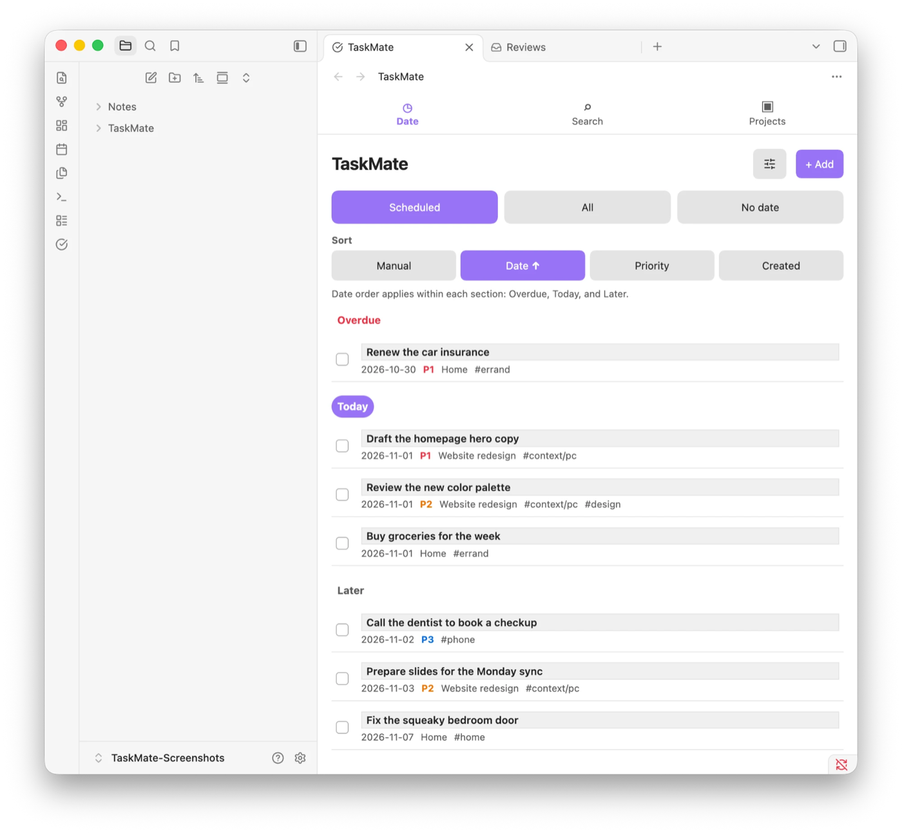
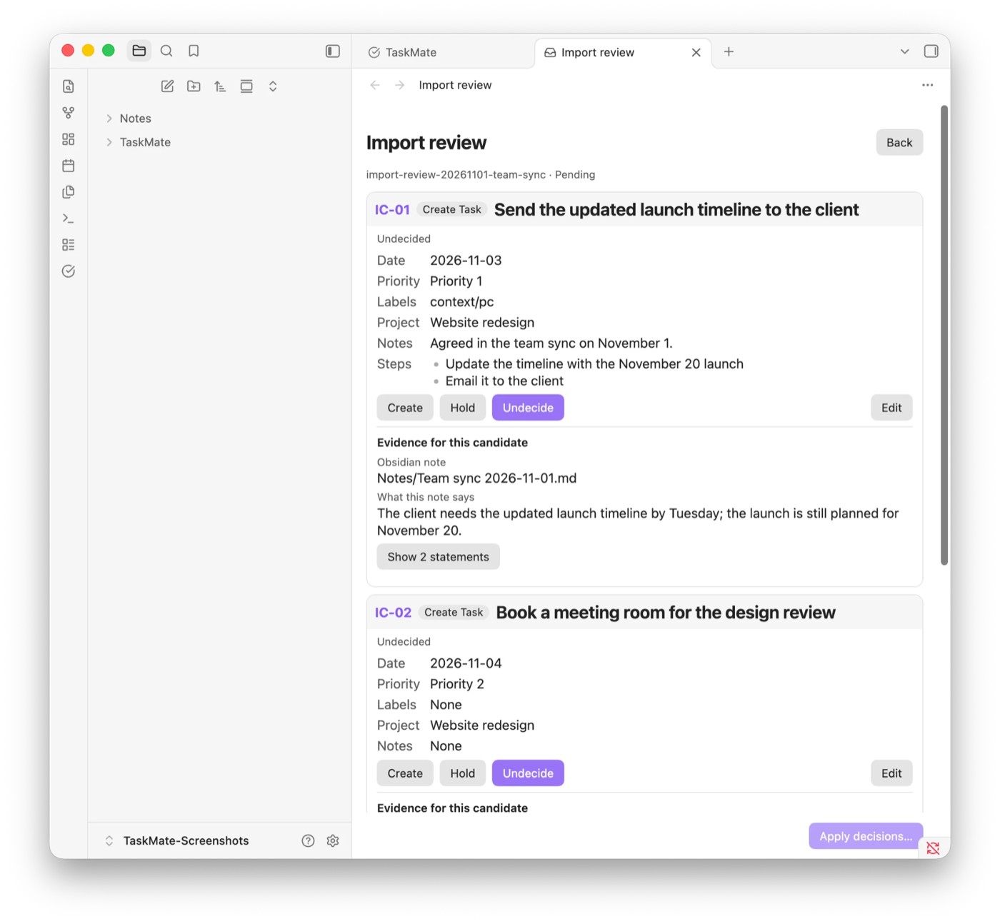

# TaskMate

English | [日本語](README.ja.md)

TaskMate is a simple, local-first task manager for Obsidian users who want a focused Todoist-style task list without leaving their vault. Every task and project stays in readable Markdown that you own.

TaskMate also includes Task Pilot, an optional AI agent skill. It turns notes you select into task suggestions and plans, and changes no task until you approve them in a TaskMate review.



## Why TaskMate

- Use the same task interface in desktop and mobile Obsidian.
- Reorder tasks manually without losing that order in other built-in views.
- Keep tasks inspectable, portable, and editable as Markdown.
- Use the plugin without creating a TaskMate account or hosted database.
- Review AI-generated proposals before they become canonical tasks.

## Install

TaskMate is listed in the Obsidian Community directory. Desktop and Android Obsidian are verified; iOS has not yet been verified.

1. In Obsidian, open **Settings → Community plugins** and select **Browse**. Turn on community plugins first if Obsidian asks.
2. Search for **TaskMate**, select **Install**, and then select **Enable**.

You can also open the [TaskMate listing](https://community.obsidian.md/plugins/taskmate) and select **Add to Obsidian**. To update, select **Check for updates** under **Settings → Community plugins**.

### Install manually from a GitHub Release

Use this method when the Community directory is not available to you.

1. Open the [TaskMate Releases page](https://github.com/tempu-village/taskmate/releases) and download these three assets from the same version:

   ```text
   main.js
   manifest.json
   styles.css
   ```

2. Create `<vault>/.obsidian/plugins/taskmate/` and place the three files directly inside it.
3. Restart Obsidian and enable TaskMate under **Settings → Community plugins**.

To update a manual installation, back up the vault, disable TaskMate, replace all three files with assets from one newer Release, and enable TaskMate again. Do not mix files from different versions.

To run an unpublished build, see [Install a development build](docs/operations/development-install.md).

## Quick start

For a guided first exercise, see [Your first TaskMate task](docs/user/getting-started.md). Goal-specific instructions are in [user guides](docs/user/README.md).

1. [Install](#install) and enable TaskMate.
2. Open the command palette and run **TaskMate: Open task list**.
3. Select **+ Add**, enter a title, and save the task.
4. Use the Date screen to view Scheduled, All, or No date tasks. Use Adjust to filter or select the current list.
5. Select **Settings → TaskMate → Language** to choose Auto, English, or 日本語.

The language change updates TaskMate views and settings immediately. Reload the plugin to update command names and the ribbon tooltip.

## Current features

- Three focused destinations: Date, Search, and Projects
- Scheduled, All, and No date views, with overdue, today, and later sections in Scheduled
- An Adjust menu that filters the current list and provides explicit task selection
- Single-task deletion in the editor and bulk editing or deletion from selection mode
- Search with up to 10 recent search terms
- Markdown-backed projects with five recent projects, rename, and safe deletion
- Priority 1–3 and up to 500 labels, with an indexed label picker, inline favorites, and filters for priority, label, and completion state
- One-tap Today, Tomorrow, 7 days later, and No date suggestions
- Compact ordered Steps with completion controls, optional dates, drag reordering, and a focused editor
- Up to 10 favorite and 10 non-duplicate recently saved label suggestions
- One global manual drag order plus date, priority, and creation sorting
- Auto, English, and 日本語 language settings with English fallback
- Desktop and mobile Obsidian support
- One readable Markdown file per task with a stable ID in frontmatter
- Explicit AI source folders with per-note include and exclude overrides
- Staged proposal review before an agent may create, merge, or exclude an action

## Install and use Task Pilot

Task Pilot is optional; the plugin works without it. Task Pilot runs in an Agent Skills-compatible AI client, such as Codex, with your vault open as its workspace. It reads only the notes you select, saves its suggestions as a review or a plan in the vault, and never changes a task by itself: every change waits until you approve it in TaskMate.



To install it, copy the `skills/taskpilot` folder from this repository into your client's skills folder, for example `~/.agents/skills/taskpilot`.

You do not need to name Task Pilot. Ask for what you want in everyday words:

> Plan my TaskMate tasks for this week.

To name it explicitly, or for a specific operation, start with `$taskpilot`:

```text
$taskpilot Review the selected source notes and stage every Task candidate for review in TaskMate.
$taskpilot Review my stale Tasks and propose safe date, Priority, and Context-label changes.
$taskpilot I have two hours. What can I do now?
$taskpilot Find work for a 30-minute phone-only break.
```

Task Pilot saves one review file in the proposal folder, opens it in TaskMate, and creates no Task at this stage; you can also run **TaskMate: Open reviews**, which lists every pending review. Each candidate is a card that quotes its source sentences. Edit a card when needed, choose to create, merge, exclude, or hold it, and then select **Apply decisions…**. TaskMate changes no Task before you confirm, asks for an extra confirmation for merges whose diff you did not open, and records the import on a source note once all of its candidates are applied. Completed reviews move to `TaskMate/Proposals/History` and remain there until you delete them. See [Review source notes and create Tasks](docs/user/how-to/import-source-notes.md) for the full steps.

Backlog changes are also shown before writing. A plan is always a rolling plan saved under `TaskMate/Plans`. A free-time Task suggestion is read-only, writes no file, uses a visible 20% default buffer and upper effort estimates, and never adds Task statuses or changes Manual order. A request that asks for a plan, such as “Plan today”, always gets a rolling plan; Task Pilot asks once only when a request names neither a plan nor free time. “Do later” removes the date instead of adding a Pending or Waiting state.

Change the proposal location under **Settings → TaskMate → Proposal folder** when needed. The proposal folder is an approval boundary, not a security sandbox, and does not expand the source-note allowlist.

### Select notes for Task Pilot

Run **TaskMate: Include current folder as an AI source**, or add one vault-relative folder per line under **Settings → TaskMate → AI source folders**.

Individual notes can override their folder rule:

```yaml
taskmate-source: true  # include this note anywhere
taskmate-source: false # exclude this note from an included folder
```

Processed source notes receive `taskmate-import-*` provenance properties. A content hash lets Task Pilot detect a later edit without treating its own metadata as a user change.

## Storage, privacy, and permissions

- Tasks are stored under `TaskMate/Tasks` by default.
- Projects are stored under `TaskMate/Projects` by default.
- Reviews are stored under `TaskMate/Proposals` by default, and completed reviews under its `History` folder.
- Folder locations can be changed in TaskMate settings.
- The plugin uses Obsidian's vault and file-management APIs to read and write TaskMate-managed Markdown.
- The plugin contains no telemetry, hosted TaskMate account, runtime AI, translation service, or TaskMate synchronization server.
- The plugin does not send task content to an external translation service.
- Task Pilot runs with the permissions of the agent client and is separate from the Obsidian plugin.
- Uninstalling the plugin leaves tasks, projects, and review files in the vault.

Review these claims against the release build before public release. Back up the vault and understand the synchronization provider's conflict behavior before using TaskMate with important data.

## Known limitations

- Calendar, Kanban, recurrence, and reminders are not included in the current release.
- TaskMate does not provide its own free synchronization service.
- Simultaneous offline edits on multiple devices may be handled as conflicts by the vault synchronization provider.
- The Android workflow has been tested; iOS has not yet been tested.
- Command names and the ribbon tooltip require a plugin reload after changing the TaskMate language.

## Troubleshooting

See [Troubleshooting](docs/user/troubleshooting.md) for recovery guidance. When reporting a bug, include the TaskMate version, Obsidian version, operating system, reproduction steps, and a sanitized example task when relevant. Do not publish private vault content.

## Development

Contributors start at [CONTRIBUTING](CONTRIBUTING.md). To build and run an unpublished version, including the Obsidian Sync procedure for desktop and Android, see [Install a development build](docs/operations/development-install.md).

### Translation workflow

English is the canonical source and fallback for TaskMate UI and user documentation.

1. Finalize changes in `src/i18n/en.ts` and English documentation.
2. Update `src/i18n/ja.ts` and Japanese documentation in the same change.
3. Check catalog keys, placeholders, Markdown structure, protected literals, and links.
4. Keep AI-created or AI-updated translations marked `ai-translated`.
5. Change the status to `human-reviewed` only after a person compares the complete current English and Japanese content.
6. Check both languages in real desktop and mobile Obsidian before release.

Do not add a feature specification only to Japanese. Update English first, then translate it. Keep code, commands, paths, property names, IDs, and URLs unchanged unless the localized UI intentionally uses a translated command label.

### Verification

```bash
npm run typecheck
npm test
npm run build
python3 -m unittest discover -s skills/taskpilot/tests -v
python3 scripts/validate_skills.py
npm run validate:localization
python3 scripts/validate_docs.py
npm run validate:release
git diff --check
```

The generated `main.js` is a build artifact. Do not edit it by hand.

Maintainers should follow the bilingual [release procedure](docs/operations/releasing.md) to update synchronized version metadata, create an exact version tag, and verify the generated GitHub Release. See the [documentation index](docs/index.md) for the complete document map.

## License

TaskMate is available under the [MIT License](LICENSE).

Copyright (c) 2026 Masashi (Tempu Village)

## Official Obsidian documentation

- [Obsidian Sync settings and selective sync](https://obsidian.md/help/sync/settings)
- [Community plugins](https://obsidian.md/help/community-plugins)
