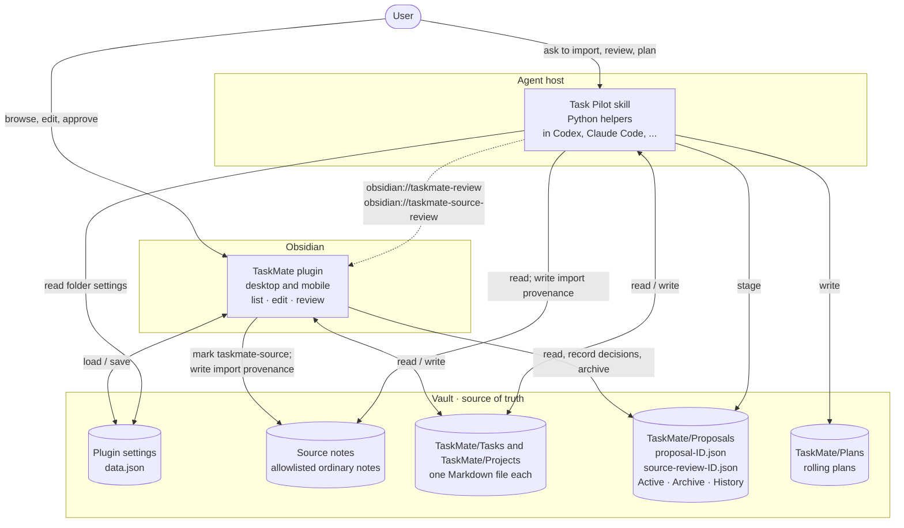
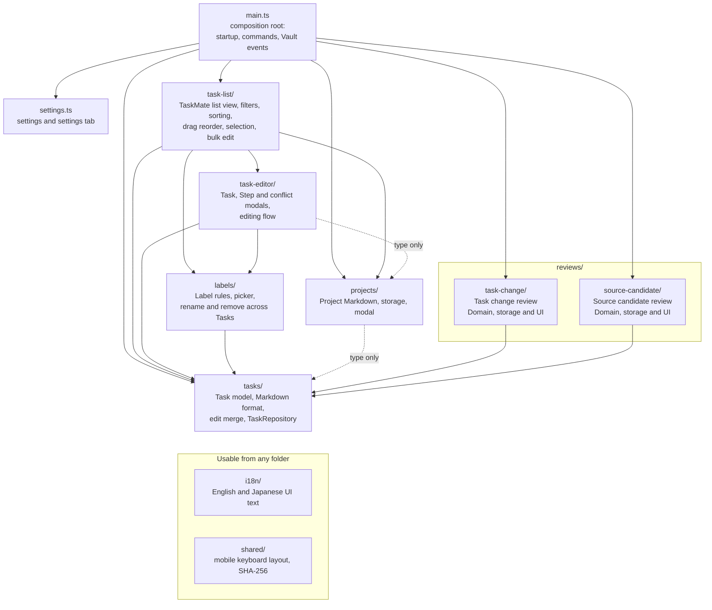
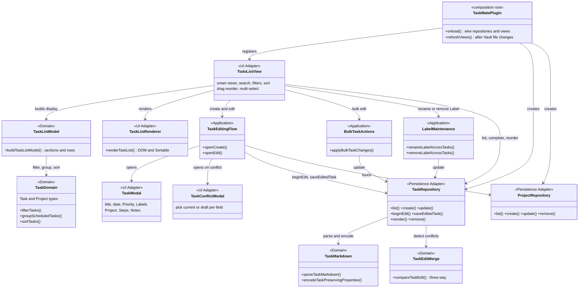
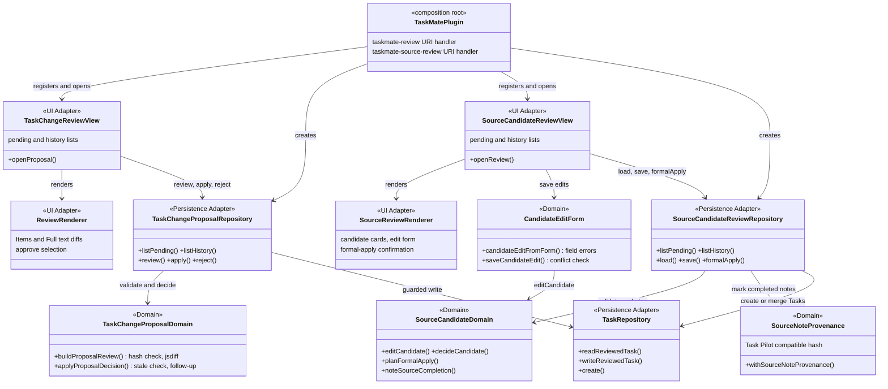
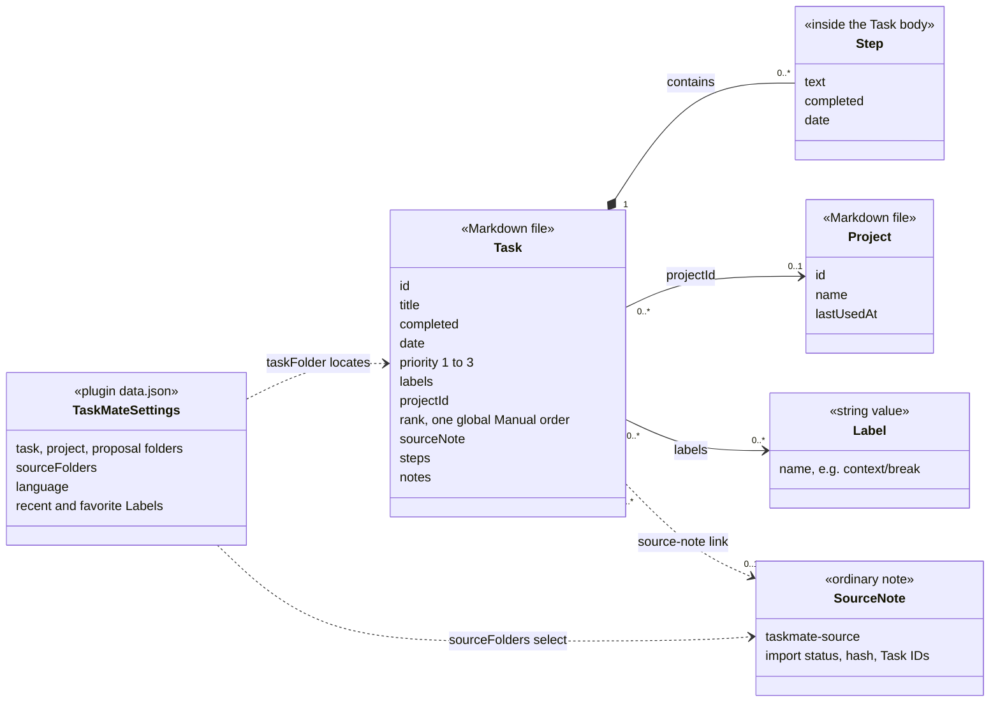
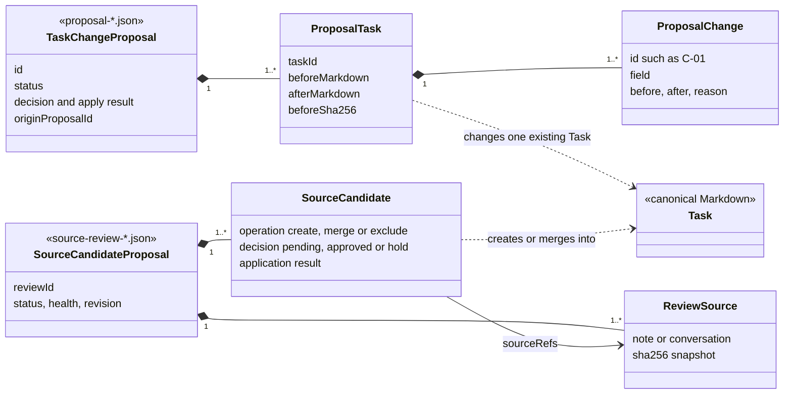
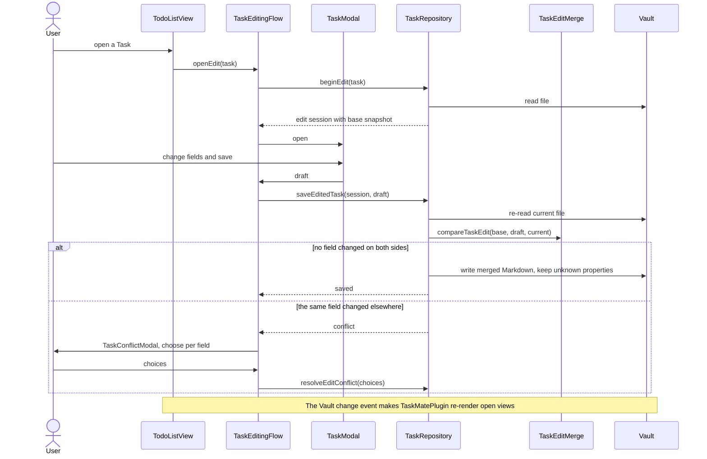
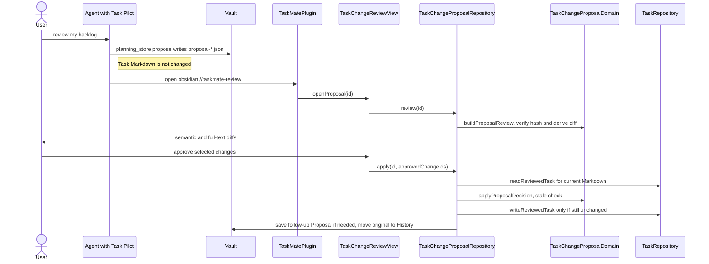
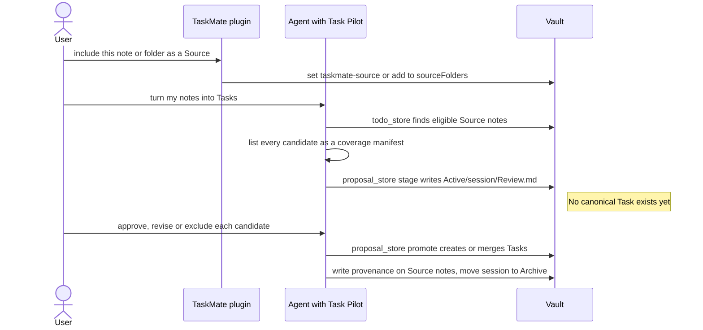

# System overview diagrams

Status: Current visual overview. [Architecture](architecture.md) owns the component map, [Module boundaries](module-boundaries.md) owns the dependency rules, and each [Feature](../features/README.md) owns its behavior. This page draws those records so a reader can explain TaskMate quickly. When it disagrees with them or with the code, they win and this page needs fixing.

## TaskMate in four sentences

1. Every Task and Project is a plain Markdown file in the Obsidian Vault; there is no database or hosted account.
2. The TaskMate plugin is the human interface: it lists, filters, edits and reorders those files on desktop and mobile.
3. Task Pilot is an optional agent skill whose Python helpers read and write the same files from an agent host such as Claude Code.
4. Whenever Task Pilot wants to change Tasks, it first stages a Proposal file that the user reviews before anything canonical changes.

## 1. System context

Who touches which files. Folder names are the defaults from [settings.ts](../../../src/settings.ts).

- Task Pilot's helpers are `todo_store` (direct Task and Project operations), `proposal_store` (current Source-note import), `planning_store` (backlog review, Task change Proposals and capacity plans), `rolling_plan` (rolling plans) and `source_review` (Source candidate Proposals).
- The plugin and Task Pilot never call each other's code. They share the file formats in [Specifications](../specifications/README.md) and Task Pilot's [Task schema](../../../skills/taskpilot/references/task-schema.md). The only direct handoffs are the URIs that open a Task change review or a Source candidate review.
- Task Pilot reads the plugin's `data.json` to find the managed folders, so both sides agree on where Tasks live.
- The plugin's Source candidate review also writes import provenance on a Source note once all of that note's candidates are applied.

## 2. Module map

Folders under `src/`, arranged by dependency level, with arrows drawn from the actual imports. Solid arrows are runtime imports and dashed arrows are type-only imports.

- Dependencies only point downward: `task-list → task-editor → labels / projects → tasks`, plus `reviews → tasks`. `tasks/` depends on no other feature folder. The [Module boundary test](../../../test/module-boundaries.test.ts) enforces this.
- `reviews/` holds one sibling Module per review kind, and review kinds never import each other.
- `task-list/view.ts`, `reviews/task-change/review-view.ts`, `reviews/source-candidate/review-view.ts` and `settings.ts` refer back to `main.ts` with type-only imports. Those references are erased at runtime and are omitted from the diagram.

## 3. Layers inside the folders

Each folder mixes the four roles from [Module boundaries](module-boundaries.md). The stereotype on each box names its role:

| Role | Responsibility | Must not |
| --- | --- | --- |
| UI Adapter | Obsidian views, modals, DOM, screen state | Contain persistence rules |
| Application | Coordinate one use case across screens and repositories | Hold rules that belong in Domain |
| Domain | Pure validation, calculation, filtering, sorting, diffing | Depend on Obsidian, DOM or the Vault |
| Persistence Adapter | Read and write Vault files, guarded writes | Be depended on by Domain |

### 3a. Task list and editing

The list view owns screen state and dispatches intent. Rules such as "which Tasks are Overdue" or "did someone else change this field" live in Domain code, so they are unit-tested without Obsidian.

### 3b. Reviews

Both review kinds follow the same shape (Domain decides, Persistence Adapter writes) but keep separate schemas and code. No `reviews/shared` Module exists until a contract is proven common.

## 4. Data model

### 4a. Canonical records

- A Task is identified by `id`, not by its file name. A Project groups Tasks by ID but does not own them; deleting a Project unassigns its Tasks.
- Steps are checklist entries inside one Task and have no identity of their own.
- `rank` is one global order. Sorting by date or Priority only changes what is displayed.
- The exact fields are owned by [Task file format](../specifications/task-file-format.md) and [Source note property format](../specifications/source-note-properties.md).

### 4b. Review records

- A Task change Proposal edits existing Tasks only. It stores complete before/after Markdown so the diff can be regenerated and a stale Task can be detected. When some writes fail or go stale, apply produces a follow-up Proposal linked by `originProposalId`. See [Task change Proposal format](../specifications/task-change-proposal-format.md).
- A Source candidate Proposal accounts for every candidate found in its sources as create, merge or exclude. Its schema is defined by [RFC 0033](../rfcs/0033-add-reviewable-rolling-plans-and-source-candidate-reviews.md), and the user reviews it in the Source candidate Review View.

## 5. Key flows

### 5a. Edit a Task without overwriting someone else's change

Details: [Edit conflicts](../features/edit-conflicts.md) and [ADR 0022](../adr/0022-prevent-stale-task-overwrites-with-three-way-comparison.md).

### 5b. Review changes suggested by Task Pilot

Details: [Task change review](../features/task-change-review/README.md).

### 5c. Turn Source notes into Tasks

The current import path runs entirely in Task Pilot. The plugin only marks which notes are in scope.

Under RFC 0033 this path is being replaced: `source_review.py` stages one `source-review-*.json`, and the user edits, decides and formally applies its candidates in the plugin's Source candidate Review View. Task Pilot takes that path when the user asks for a TaskMate review; the path above stays the default until [#62](https://github.com/tempu-village/taskmate/issues/62) retires it. Details: [Source-note import](../features/source-import.md).

## 6. Where each feature lives

| Feature | What the user gets | Main code |
| --- | --- | --- |
| [Navigation, filtering and sorting](../features/filtering-and-sorting.md) | Scheduled, Unplanned and All views; search, Priority and Label filters; sort; drag to reorder | `task-list/`, `tasks/domain.ts` |
| [Task editing](../features/task-editing.md) | Create, edit, complete and delete a Task | `task-editor/`, `tasks/` |
| [Task Steps](../features/task-steps.md) | Optionally dated checklist inside a Task | `task-editor/step-modal.ts`, `tasks/task-steps.ts`, `tasks/task-body.ts` |
| [Edit conflicts](../features/edit-conflicts.md) | No silent overwrite when the file changed meanwhile | `tasks/task-edit-merge.ts`, `tasks/repository.ts`, `task-editor/task-conflict-modal.ts` |
| [Projects](../features/projects.md) | Group Tasks into named Projects | `projects/` |
| [Labels](../features/labels.md) | Label picker, favorites, rename and remove | `labels/` |
| [Mobile layout](../features/mobile-layout.md) | Usable editors and lists on phones | `shared/mobile-keyboard-layout.ts`, `styles.css` |
| [Localization](../features/localization.md) | English and Japanese UI | `i18n/` |
| [Storage and privacy](../features/storage-and-privacy.md) | Plain Markdown in the user's Vault | `tasks/repository.ts`, `projects/project-repository.ts` |
| [Task change review](../features/task-change-review/README.md) | Approve AI-suggested changes field by field | `reviews/task-change/`, Task Pilot `planning_store.py` |
| [Source-note import](../features/source-import.md) | Turn selected notes into Tasks with nothing silently dropped | Task Pilot `todo_store.py`, `proposal_store.py`; next: `reviews/source-candidate/`, `source_review.py` |
| [Task Pilot review and capacity planning](../features/task-pilot-planning.md) | Backlog review and plans sized to available time | Task Pilot `planning_store.py`, `rolling_plan.py` |

## 日本語参考

<!-- translation-status: ai-translated -->

> 翻訳状態：`ai-translated`。英語版が正本です。

TaskMateを説明するための図をまとめたページです。正本は[Architecture](architecture.md)、[Module boundaries](module-boundaries.md)、各[Feature](../features/README.md)で、このページはそれらを図にしたものです。内容が食い違う場合は正本とコードを優先し、このページを直します。

### 4文で言うと

1. TaskとProjectは、どちらもVault内の普通のMarkdownファイルです。データベースやアカウントは要りません。
2. TaskMateプラグインは人が使う画面です。PCとスマホで、そのファイルを一覧・絞り込み・編集・並べ替えします。
3. Task Pilotは任意のエージェントスキルです。Claude Codeなどの中でPythonの補助スクリプトが同じファイルを読み書きします。
4. Task PilotがTaskを変えたいときは、まずProposal（提案）ファイルを置きます。正本のTaskが変わるのは、利用者がレビューして承認したあとだけです。

### 図の読み方

- **1. System context**：誰がどのファイルに触るかを示します。プラグインとTask Pilotはお互いのコードを呼ばず、同じファイル形式を共有して連携します。直接の受け渡しは、Task変更レビューを開く`obsidian://taskmate-review`と、Source候補レビューを開く`obsidian://taskmate-source-review`のURIだけです。Task Pilotはプラグインの`data.json`を読み、管理フォルダーの場所を合わせます。
- **2. Module map**：`src/`のフォルダーを依存の段ごとに並べた図です。矢印は実際のimportから描いています。依存は下向きだけで、`task-list → task-editor → labels / projects → tasks`、`reviews → tasks`です。`tasks/`はほかの機能フォルダーに依存しません。この規則はModule boundary testで自動確認しています。`i18n/`と`shared/`はどこからでも使えます。
- **3. Layers**：各フォルダーの中身を4つの役割で示します。UI Adapterは画面、Applicationは操作の段取り、Domainは純粋なルール（Obsidianに依存しない）、Persistence Adapterはファイルの読み書きです。3aは一覧と編集、3bはレビューの主要クラスです。2種類のレビューは同じ形をしていますが、スキーマとコードは別々に保っています。
- **4. Data model**：4aは正本のデータです。TaskはStepを中に持ち、IDでProjectを参照し、Labelは文字列です。`rank`は全体で一つの手動順です。4bはレビュー用のデータです。Task変更Proposalは既存Taskの変更前後のMarkdownを丸ごと持ち、Source候補Proposalは元ノートから見つけた候補をすべて作成・統合・除外のいずれかに振り分けます。
- **5. Key flows**：5aは編集保存の流れです。開いたときの内容・自分の編集・今のファイルを3方向で比べ、同じ項目が両方で変わっていれば項目ごとに選んでもらいます。5bはTask Pilotの変更提案を承認する流れです。承認した変更だけを、元の内容から変わっていない場合に書き込みます。5cはメモからTaskを作る今の流れで、Task Pilotの中で完結します。RFC 0033で、プラグイン側のSource候補レビューに置き換える作業が進んでいます。Review Viewで候補の編集・判断・正式反映ができ、Task PilotはTaskMateでのレビューを頼まれたときにこちらを使います。古い流れは#62で廃止するまで既定のままです。
- **6. Where each feature lives**：機能ごとに、利用者が得られることと主なコードの場所を対応させた表です。
